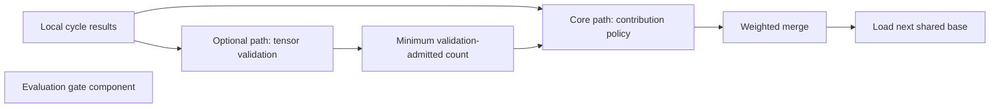

# Update admission and aggregation influence review

Status: Candidate for maintainer review. Reviewed 8 November 2026 (Europe/Oslo). This is a bounded assessment of a public proof of concept, not a deployment assessment or an accepted security policy.

## Result

With model states held fixed, changing quality metadata changes quality-weighted aggregation. A feasible configured cap limits this effect in the measured cases. Equal weighting removes score-magnitude sensitivity above the floor, while the floor still controls eligibility. These are executable observations, not evidence of fabricated metadata in a deployed system or a demonstrated poisoning attack.

The next useful decision is who establishes the quality score and what authority that score should have over admission and influence. Any security failure claim needs that agreed expectation.

## Version and scope

Pinned source: [`3d44c130b78c3b2ce4bd042603873d55ede89faf`](https://github.com/The-AI-Alliance/tapestry/commit/3d44c130b78c3b2ce4bd042603873d55ede89faf), retrieved from `develop`. The [manifest](../../experiments/aggregation-influence/sources.json) identifies the 36 reviewed or executed files and their digests. No upstream source was changed.

In scope: local contribution construction, the core coordinator, contribution policy, weighted-average merge and the optional validating coordinator. Evaluation gate code was inspected to distinguish release decisions from round integration. Out of scope: deployed configuration, network ingress, key distribution, local training correctness, adversarial model quality, publication and rollback enforcement.

## Source-backed flow

| Stage | Evidence and bounded conclusion |
|---|---|
| Contribution construction | [Node source][S1] stores the constructor-supplied quality score and copies it into the contribution. This path does not independently compute that score from validation results. |
| Core round | [Coordinator][S2] collects local cycle results, passes scores to policy, merges accepted states and loads the result into the base. No call to the contributed validator or evaluation gate is present in this method. |
| Optional validation | [Validating coordinator][S3] validates tensor contributions and checks a minimum number of validation-admitted participants before invoking policy. This is a separate contributed path. Its default minimum is 1. |
| Eligibility and influence | [Policy][S4] filters by quality floor. Quality weighting normalizes scores and applies the configured cap; equal weighting distributes influence uniformly among eligible IDs. Defaults are floor 0, cap 1 and quality weighting. |
| Integration | [Merge][S5] computes the weighted average in the default strategy. Other strategies exist but were not exercised here. |
| Release evaluation | [Evaluation gate][S6] decides supplied benchmark results and bundles. Its existence does not establish that a coordinator round invokes it or that publication enforces its decision. |
| Requirements | [Infrastructure requirements][S7] call for checks before updates affect shared artifacts and for proportionate observability. These requirements are intent, separate from runtime enforcement. |

The evaluation component is deliberately unconnected in this diagram: integration into the reviewed round method was not evidenced. This says nothing about unreviewed orchestration or other deployments.

## Work products

- [Threat model](threat-model.md): assets, actors, assumptions and candidate expectations.
- [Evidence register](evidence.md): source observations, execution and limits.
- [Residual risk register](residual-risk.md): unresolved exposure and accountable decisions.
- [Maintainer review package](maintainer-review.md): short findings and policy questions; draft only.
- [Reproducible experiment](../../experiments/aggregation-influence/README.md): 26 cases, pinned sources and recorded results.

No risk has been accepted by this review. No upstream issue, comment or pull request was posted. Revisit on changes to scoring authority, filtering, participant-count semantics, validation integration, merge strategy or release orchestration.

[S1]: https://github.com/The-AI-Alliance/tapestry/blob/3d44c130b78c3b2ce4bd042603873d55ede89faf/src/tapestry/training/consortium/node.py#L30-L77
[S2]: https://github.com/The-AI-Alliance/tapestry/blob/3d44c130b78c3b2ce4bd042603873d55ede89faf/src/tapestry/training/consortium/coordinator.py#L41-L72
[S3]: https://github.com/The-AI-Alliance/tapestry/blob/3d44c130b78c3b2ce4bd042603873d55ede89faf/contrib/build4me2-contribution-validator/contribution_validator/gate.py#L68-L133
[S4]: https://github.com/The-AI-Alliance/tapestry/blob/3d44c130b78c3b2ce4bd042603873d55ede89faf/src/tapestry/training/consortium/policy.py#L27-L80
[S5]: https://github.com/The-AI-Alliance/tapestry/blob/3d44c130b78c3b2ce4bd042603873d55ede89faf/src/tapestry/training/consortium/merge.py#L60-L95
[S6]: https://github.com/The-AI-Alliance/tapestry/blob/3d44c130b78c3b2ce4bd042603873d55ede89faf/src/tapestry/evaluation/gates.py#L188-L286
[S7]: https://github.com/The-AI-Alliance/tapestry/blob/3d44c130b78c3b2ce4bd042603873d55ede89faf/docs/work-groups/infrastructure-operations/infrastructure-requirements.md#L94-L119
